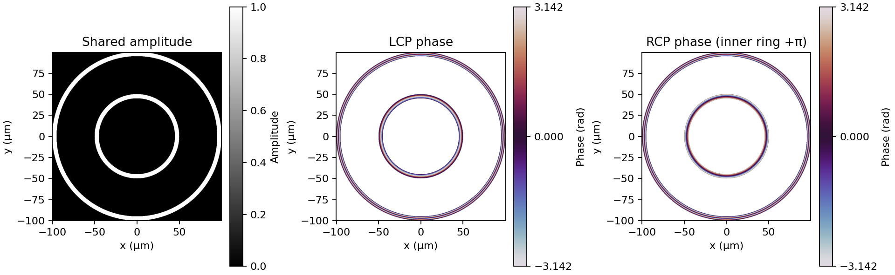
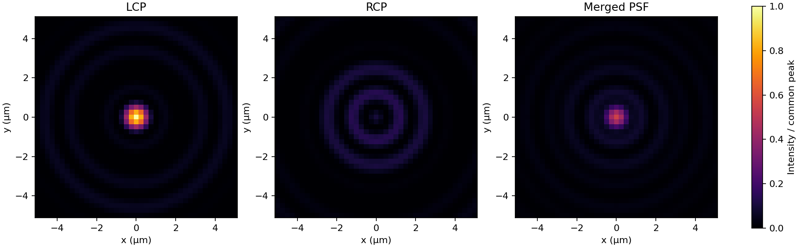
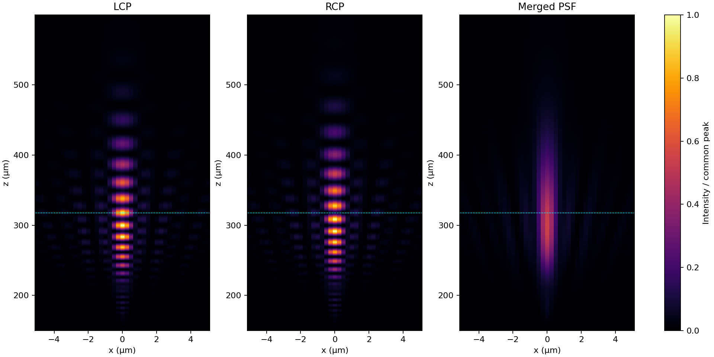
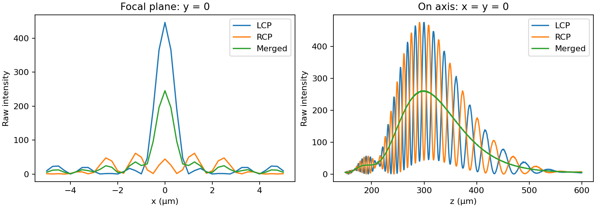

# Droplet Bessel beam metalens (DBBM)

English | [한국어](README.ko.md)

A minimal CPU simulation: **200 µm amplitude/phase design → LCP/RCP propagation → merged PSF**.
Open [demo.ipynb](demo.ipynb) and run all cells. The folder is self-contained.

## Run

With Docker Desktop running Linux containers, from this folder:

```bash
docker compose -f docker/compose.yaml up --build
```

Open the token-bearing Jupyter URL printed in the logs, replacing port 8888 with
**8890**. Select `demo.ipynb`, then **Restart Kernel and Run All Cells**.
The container is limited to 2 CPUs and 8 GiB RAM. Port 8890 permits running beside
Hadamard (8888) and MMISM (8889). No GPU or input-data download is needed.

```bash
docker compose -f docker/compose.yaml down
```

Alternatively, with Python 3.12:

```bash
python -m pip install -r docker/requirements.txt
python -m jupyter lab demo.ipynb
```

## Simulation

1. Create two inward annuli with common amplitude and spherical focusing phase.
   Add π only to the inner ring of RCP.
2. Propagate both ideal polarization channels independently with the MMISM ASM core.
3. Merge unnormalized intensities as `(I_LCP + I_RCP) / 2`, assuming equal incident
   powers and polarization-insensitive detection. Fields are orthogonal; do not sum
   them coherently. Inter-ring interference cancels in this equal-weight merge.
4. Show focal XY, axial XZ, and raw lateral/on-axis profiles. Each image comparison
   uses one common maximum, preserving channel brightness differences.






## Parameters

| Parameter | Value |
|---|---|
| Diameter | 200 µm |
| Wavelength / medium | 633 nm / air |
| NA / design focus | 0.3 / 317.980 µm |
| Inner/outer ring diameter ratio | 0.5 |
| Common radial ring width | 5 µm |
| Grid / pitch | 800² / 0.25 µm |
| Padded grid | 1600² (2× field width) |
| Axial planes | 150–399.9 µm, 0.3 µm steps (834 planes) |
| Display ROI | x,y approximately ±5 µm |

## Code and scope

- `demo.ipynb`: four code cells: parameters, design, focal PSF, and axial PSF/profiles.
- `lib/phase.py`: minimal original DBBM design adaptation.
- `lib/asm.py`: same diffractsim ASM adaptation as MMISM.
- `images/`: figures generated by the notebook.

The π-offset convention follows the original incident LCP/RCP channel labels.
This is ideal scalar polarization-channel propagation. It does not simulate
meta-atom efficiency, leakage, fabrication, vector focusing or image reconstruction.
The annular PSF differs from a filled-aperture Airy PSF. Finite sampling and FFT
wraparound remain numerical limitations; 2× padding is not a convergence proof.
The fixed example parameters are not claimed optimal or a reproduction of a published figure.
The original GPU RS solver is not used. No full 3D volume is retained. The axial calculation evaluates only the central inverse-FFT row and reuses the spectrum with a fixed-step transfer phase; it retains the same discrete ASM. The wider range shows the main PSF and decaying tails, not mathematically infinite support.

Copy this folder independently; retain `LICENSE`, `licenses/`, and
[THIRD_PARTY_NOTICES.md](THIRD_PARTY_NOTICES.md) when reusing the code.
Surrounding software uses GPL-3.0; the included diffractsim adaptation retains MPL 2.0 notices.

The four notebook cells were executed in the DBBM Docker environment. Numerical checks are performed separately during development and are not part of the demo.

Lateral sampling uses the thin-ring intensity estimate FWHM ≈ 0.358 λ/NA = 0.755 µm. At least three samples per FWHM are required; rounding the grid up to a multiple of 32 gives 800² and dx = dy = 0.25 µm (3.022 samples). This is a grid-selection estimate; the merged two-ring PSF width is measured separately during validation. The selected 150–399.9 µm axial window is retained and does not include every tail.
